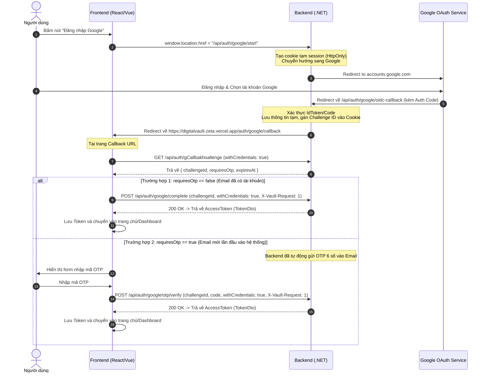

# Hướng dẫn tích hợp Đăng nhập Google (Google Login) cho Frontend

Tài liệu này hướng dẫn chi tiết quy trình tích hợp API đăng nhập Google giữa Frontend (React/Vue/Next.js/v.v.) và Backend `LegacyVault`.

---

## 1. Bản chất luồng xác thực Google (OIDC Flow)

> [!IMPORTANT]
> **KHÔNG** gọi endpoint `/api/auth/google/start` bằng `fetch()` hoặc `axios.get()`.
> Đây là một endpoint chuyển hướng (Redirect/OAuth Challenge). Frontend phải điều hướng trình duyệt (**Browser Navigation**) hoặc mở popup.

### Sơ đồ quy trình:



---

## 2. Danh sách Endpoint API

Base URL mẫu: `https://vault-owner-be.huydevops.id.vn`

| Method | Endpoint | Bắt buộc | Mô tả |
| :--- | :--- | :--- | :--- |
| **GET** | `/api/auth/google/start` | Browser Navigation | Bắt đầu quy trình. Chuyển hướng người dùng sang Google. |
| **GET** | `/api/auth/google/challenge` | `withCredentials: true` | Lấy mã Challenge và xem tài khoản có cần OTP hay không. |
| **POST** | `/api/auth/google/complete` | `withCredentials: true`<br/>`X-Vault-Request: 1` | Đăng nhập tài khoản cũ (không cần OTP). Nhận JWT. |
| **POST** | `/api/auth/google/otp/verify` | `withCredentials: true`<br/>`X-Vault-Request: 1` | Xác minh OTP cho tài khoản mới đăng ký lần đầu. Nhận JWT. |
| **POST** | `/api/auth/google/otp/resend` | `withCredentials: true`<br/>`X-Vault-Request: 1` | Gửi lại mã OTP (cooldown 60 giây). |

---

## 3. Hướng dẫn Code mẫu cho Frontend

### Bước 1: Nút "Đăng nhập với Google"
Khi người dùng bấm nút:
```javascript
const handleGoogleLogin = () => {
  // Thay thế bằng domain backend thực tế
  const BACKEND_URL = "https://vault-owner-be.huydevops.id.vn";
  window.location.href = `${BACKEND_URL}/api/auth/google/start`;
};
```

---

### Bước 2: Tạo trang Callback trên Frontend (Ví dụ Route: `/auth/google/callback`)
Backend sau khi nhận callback từ Google sẽ tự chuyển hướng trình duyệt về URL này.
Tại trang này, FE gọi API `GET /api/auth/google/challenge`:

```javascript
import { useEffect, useState } from 'react';
import axios from 'axios';

const BACKEND_URL = "https://vault-owner-be.huydevops.id.vn";

export default function GoogleCallbackPage() {
  const [loading, setLoading] = useState(true);
  const [challenge, setChallenge] = useState(null);
  const [otpCode, setOtpCode] = useState('');
  const [error, setError] = useState('');

  useEffect(() => {
    checkGoogleChallenge();
  }, []);

  const checkGoogleChallenge = async () => {
    try {
      // BẮT BUỘC có withCredentials: true để gửi kèm cookie của Backend
      const response = await axios.get(`${BACKEND_URL}/api/auth/google/challenge`, {
        withCredentials: true
      });

      const data = response.data; // { challengeId: string, expiresAt: string, requiresOtp: boolean }
      setChallenge(data);

      // Nếu tài khoản cũ (không cần OTP), tự động gọi complete luôn
      if (!data.requiresOtp) {
        await handleCompleteLogin(data.challengeId);
      } else {
        setLoading(false); // Hiện form cho người dùng nhập OTP gửi về mail
      }
    } catch (err) {
      setError(err.response?.data?.detail || "Đăng nhập Google thất bại hoặc phiên đã hết hạn.");
      setLoading(false);
    }
  };

  // Hoàn tất đăng nhập cho tài khoản không cần OTP
  const handleCompleteLogin = async (challengeId) => {
    try {
      const response = await axios.post(
        `${BACKEND_URL}/api/auth/google/complete`,
        { challengeId },
        {
          withCredentials: true,
          headers: {
            "X-Vault-Request": "1" // BẮT BUỘC theo bảo mật backend
          }
        }
      );

      onLoginSuccess(response.data);
    } catch (err) {
      setError(err.response?.data?.detail || "Xác thực đăng nhập thất bại.");
      setLoading(false);
    }
  };

  // Xác minh mã OTP đối với tài khoản mới đăng ký lần đầu
  const handleVerifyOtp = async (e) => {
    e.preventDefault();
    try {
      const response = await axios.post(
        `${BACKEND_URL}/api/auth/google/otp/verify`,
        {
          challengeId: challenge.challengeId,
          code: otpCode
        },
        {
          withCredentials: true,
          headers: {
            "X-Vault-Request": "1"
          }
        }
      );

      onLoginSuccess(response.data);
    } catch (err) {
      setError(err.response?.data?.detail || "Mã OTP không hợp lệ hoặc đã hết hạn.");
    }
  };

  // Gửi lại mã OTP
  const handleResendOtp = async () => {
    try {
      const response = await axios.post(
        `${BACKEND_URL}/api/auth/google/otp/resend`,
        { challengeId: challenge.challengeId },
        {
          withCredentials: true,
          headers: {
            "X-Vault-Request": "1"
          }
        }
      );
      setChallenge(prev => ({ ...prev, challengeId: response.data.challengeId }));
      alert("Đã gửi lại mã OTP vào email!");
    } catch (err) {
      alert(err.response?.data?.detail || "Chưa thể gửi lại, vui lòng chờ 60 giây cooldown.");
    }
  };

  const onLoginSuccess = (data) => {
    // 1. Lưu AccessToken (localStorage / sessionStorage / State)
    localStorage.setItem("accessToken", data.accessToken);
    
    // 2. Nếu trả về 202 (tài khoản có bật 2FA 2 lớp bảo mật), chuyển sang trang verify 2FA:
    if (data.requiresTwoFactor) {
      window.location.href = `/auth/2fa?challengeId=${data.challengeId}`;
      return;
    }

    // 3. Chuyển hướng vào trang chính
    window.location.href = "/dashboard";
  };

  if (loading) return <div>Đang xử lý đăng nhập Google...</div>;
  if (error) return <div style={{ color: 'red' }}>{error} <br/><a href="/login">Thử lại</a></div>;

  return (
    <div>
      <h2>Xác thực Email tài khoản mới</h2>
      <p>Một mã OTP 6 số đã được gửi đến email Google của bạn. Vui lòng nhập để hoàn tất tạo tài khoản:</p>
      
      <form onSubmit={handleVerifyOtp}>
        <input 
          type="text" 
          maxLength={6} 
          placeholder="Nhập mã OTP 6 số" 
          value={otpCode}
          onChange={(e) => setOtpCode(e.target.value)}
          required
        />
        <button type="submit">Xác nhận</button>
      </form>

      <button type="button" onClick={handleResendOtp} style={{ marginTop: '10px' }}>
        Gửi lại mã OTP
      </button>
    </div>
  );
}
```

---

## 4. Các lưu ý quan trọng cần kiểm tra

1. **`withCredentials: true`**:
   - Mọi request trong luồng Google (`/challenge`, `/complete`, `/otp/verify`, `/otp/resend`) **phải có `withCredentials: true`**. Backend cần đọc cookie tạm thời đã được tạo từ bước `/start`.

2. **Header `X-Vault-Request: 1`**:
   - Tất cả request `POST` trong luồng Google **bắt buộc** phải gửi kèm header này để vượt qua lớp bảo vệ CSRF của Backend.

3. **Cấu hình CORS & Callback URL**:
   - Domain của Frontend (ví dụ `https://fe.example.com` hoặc `http://localhost:5173`) phải được phía Backend thêm vào `Cors:Origins`.
   - Phía Backend cần đặt `Google:FrontendCallbackUrl` trỏ đúng về URL của Frontend (ví dụ `https://fe.example.com/auth/google/callback`).

4. **Lỗi `503 - "Configure Google:ClientId and Google:ClientSecret first."`**:
   - Nếu gặp lỗi này, là do Backend trên server chưa được cấu hình Client ID và Client Secret từ Google Cloud Console. Cần liên hệ người quản trị Backend để thêm cấu hình.

---

## 5. Hướng dẫn cấu hình trên Google Cloud Console (Sửa lỗi `redirect_uri_mismatch`)

Để sửa lỗi đăng nhập Google OAuth (`Error 400: redirect_uri_mismatch`), người giữ tài khoản quản trị Google Cloud Console cần cập nhật cấu hình cho OAuth 2.0 Client ID theo các bước sau:

1. **Truy cập trang quản lý**: Đi tới trang **Google Cloud Console > APIs & Services > Credentials** (`https://console.cloud.google.com/apis/credentials`).
2. **Chọn Client ID**: Trong danh sách **OAuth 2.0 Client IDs**, bấm chọn Client ID tương ứng của dự án (mã ID bắt đầu bằng `654216346433-0ubl52nuqmumaqm8unvv1v7rkhtin0qg...`).
3. **Thêm Authorized JavaScript origins**: Tại mục **Authorized JavaScript origins**, bấm **+ ADD URI** và thêm các đường dẫn sau:
   ```text
   https://vault-owner-be.huydevops.id.vn
   ```
   ```text
   https://digitalvault-zeta.vercel.app
   ```
   *(Nếu test dưới máy local, thêm cả `http://localhost:5173` và `https://localhost:7015`)*
4. **Thêm Authorized redirect URIs**: Kéo xuống mục **Authorized redirect URIs** (URI chuyển hướng được ủy quyền), bấm **+ ADD URI** và dán chính xác địa chỉ sau:
   ```text
   https://vault-owner-be.huydevops.id.vn/api/auth/google/oidc-callback
   ```
   *(Nếu test dưới máy local, thêm cả `https://localhost:7015/api/auth/google/oidc-callback`)*
5. **Lưu cấu hình**: Bấm nút **SAVE (Lưu)** ở cuối trang, đợi khoảng 30 giây đến 1 phút để Google đồng bộ rồi thử đăng nhập lại.
